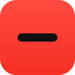
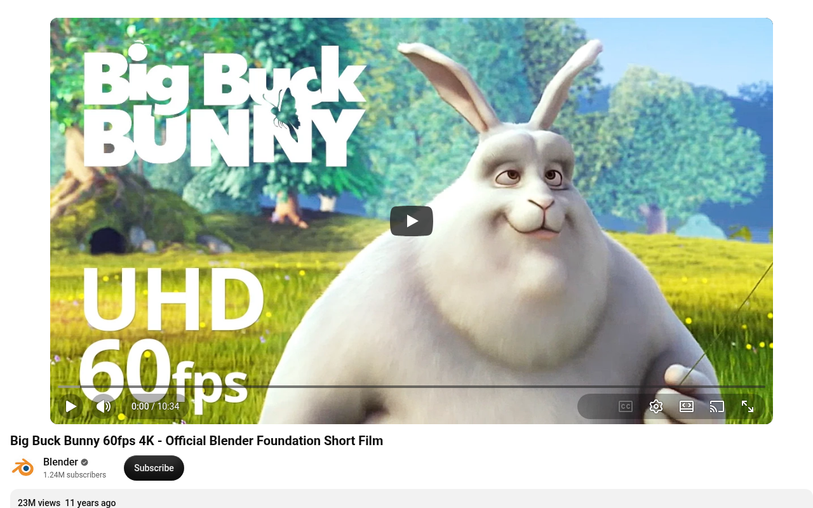
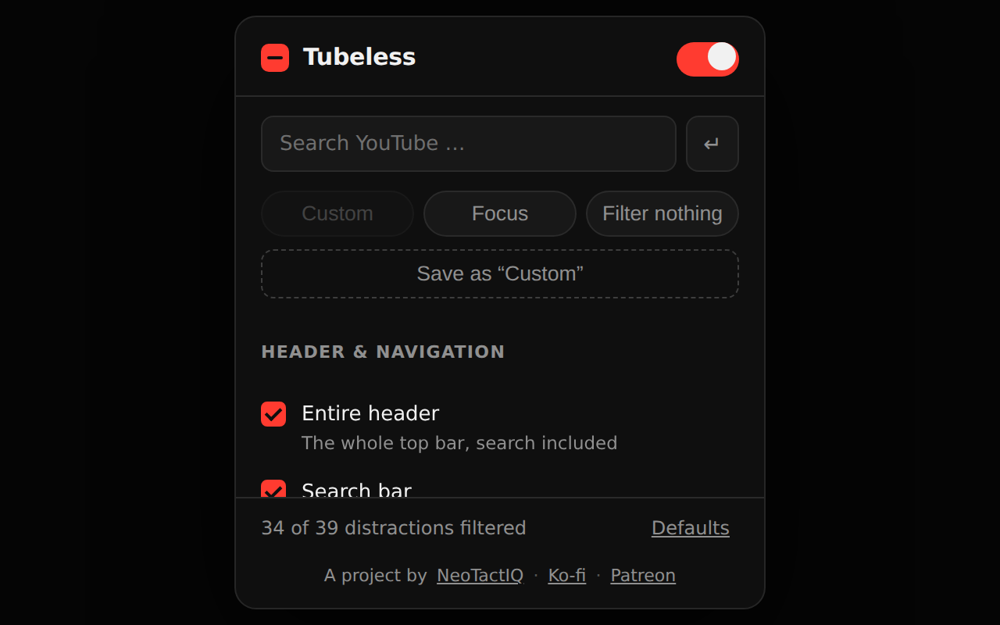

<p align="center">
  
</p>

<h1 align="center">Tubeless</h1>

<p align="center"><em>YouTube ohne Ablenkung.</em></p>

<p align="center">
  <a href="https://chromewebstore.google.com/detail/ibabglinmoklbdpplofmoicgbknbejee"></a>
  <a href="https://addons.mozilla.org/firefox/addon/tubeless-distractionfree-yt/"></a>
  
  
  
  
</p>

<p align="center"><b><a href="https://chromewebstore.google.com/detail/ibabglinmoklbdpplofmoicgbknbejee">Für Chrome installieren</a> · <a href="https://addons.mozilla.org/firefox/addon/tubeless-distractionfree-yt/">Für Firefox installieren</a></b></p>

<p align="center"><em>Deutsche Fassung — <a href="README.md">English version</a></em></p>

---

Chrome-Extension, die YouTube auf das reduziert, weswegen du hingegangen bist:
das Video. Kein Feed, keine Empfehlungen, keine Shorts, keine Kommentare, keine
Endcards, kein Autoplay.

41 einzeln schaltbare Filter, drei Presets, davon eines selbst belegbar.
Standardmäßig ist alles aus, was ablenkt — sichtbar bleiben nur Player, Titel,
Kanal und Beschreibung.

Oberfläche in [zwölf Sprachen](#sprachen), gewählt nach den Spracheinstellungen
des Browsers. Texte für den Store liegen in [`docs/`](docs/store-listing.de.md).

<table>
  <tr>
    <td width="60%"></td>
    <td width="40%"></td>
  </tr>
  <tr>
    <td align="center"><sub>Die Videoseite: das Video, sonst nichts.</sub></td>
    <td align="center"><sub>Das Popup: Presets, Suche, 42 Filter.</sub></td>
  </tr>
</table>

## Installieren

**Der einfache Weg:** [im Chrome Web Store installieren](https://chromewebstore.google.com/detail/ibabglinmoklbdpplofmoicgbknbejee) — Updates
kommen automatisch.

**Aus dem Quelltext** (zum Entwickeln, oder wenn du lesen willst, was du
ausführst):

1. `chrome://extensions` öffnen
2. **Entwicklermodus** oben rechts einschalten
3. **Entpackte Erweiterung laden** → diesen Ordner auswählen
4. YouTube neu laden

Es gibt keinen Build-Schritt — der Ordner *ist* die Extension. Beachte: die
entpackte Kopie hat eine andere Extension-ID als die Store-Version, beide
führen also getrennte Einstellungen.

**Firefox:** [über addons.mozilla.org installieren](https://addons.mozilla.org/firefox/addon/tubeless-distractionfree-yt/) — gleicher Code,
Firefox 140+, nur das Manifest unterscheidet sich (siehe Kopf von
`tools/build.py`). Für einen unsignierten Build stattdessen
`dist/tubeless-firefox-<version>.xpi` über
`about:debugging#/runtime/this-firefox` → **Temporäres Add-on laden**.

## Paketieren

Ein Befehl baut alles, Versionsnummer im Dateinamen:

```bash
python3 tools/build.py        # -> dist/tubeless-chrome-<v>.zip
                              #    dist/tubeless-firefox-<v>.xpi
                              #    dist/tubeless-<v>.crx (nur lokal, s. u.)
```

Ein GitHub-Actions-Workflow führt denselben Build bei jedem Push aus und
committet die Ergebnisse nach `dist/` — nach `git pull` passen die Pakete
immer zum Code. Nur die `.crx` entsteht ausschließlich lokal, weil sie den
privaten Schlüssel braucht.

**Store-Uploads brauchen das nackte ZIP, nicht die `.crx`** — der Chrome Web
Store signiert serverseitig und lehnt `.crx`-Dateien als ungültig ab. Für
Firefox/AMO ist es das `.xpi`.

`dist/tubeless-<v>.crx` ist das signierte Archiv-Paket, Extension-ID
`inhgfhfdblpbmpohoocoaepcjhoghbij`. Aktuelle Chrome-Versionen verweigern die
Installation von `.crx`-Dateien außerhalb des Web Store — die Datei ist zur
Archivierung und Weitergabe da, installiert wird über den Weg oben.

Das Paket enthält nur, was zur Laufzeit gebraucht wird: `manifest.json`,
`_locales/`, `src/`, `popup/`, `icons/`, die README und die LICENSE.
`tools/`, `docs/` und `dist/` bleiben draußen.

Die `.crx` lässt sich auch über `chrome://extensions` → **Erweiterung
packen** bauen — dieses Verzeichnis als Stammverzeichnis, den vorhandenen
Schlüssel als Privatschlüssel. Ohne denselben Schlüssel ändert sich die
Extension-ID. `tools/build.py` umschifft die Snap-Eigenheit automatisch:
Snap-Chromium kommt weder an `~/.config` noch an `/tmp` heran, deshalb liegen
Schlüssel und Staging vorübergehend an einem Pfad, dessen erste Ebene unter
`$HOME` kein Punkt-Verzeichnis ist (sonst „Privater Schlüssel konnte nicht
gelesen werden").

Der Schlüssel liegt **nicht im Repo**, sondern unter
`~/.config/tubeless/tubeless.pem` (Modus 600). Wer ihn hat, kann Pakete
signieren, die Chrome als dieselbe Extension akzeptiert und als Update
durchwinkt — deshalb steht `*.pem` in der `.gitignore`. Geht er verloren,
bekommt die Extension beim nächsten Packen eine neue ID.

## Bedienung

Klick aufs Tubeless-Icon in der Toolbar:

| Element | Wirkung |
|---|---|
| Schalter oben rechts | Pausiert Tubeless komplett (YouTube unverändert) |
| **Kurze Pause** | Setzt alles für 5/15/30 Minuten oder eine eigene Dauer aus |
| **Nur filtern zwischen** | Fokuszeit: außerhalb des Fensters filtert Tubeless nicht |
| Suchfeld | Ersatz für die ausgeblendete YouTube-Suchleiste |
| **Eigene** | Die selbst gespeicherte Auswahl — grau, solange keine da ist |
| **Fokus** | Wie Standard, aber Kopfzeile und Suche bleiben; Sponsor-Segmente und Intros werden markiert und übersprungen (SponsorBlock) |
| **Nichts filtern** | Alle Filter aus |
| **Standard** (unten) | Zurück zur Auslieferungseinstellung |

Änderungen greifen sofort, ohne Reload, in allen offenen Tabs. Die Einstellungen
liegen in `chrome.storage.sync`, wandern also mit dem Chrome-Profil mit.

### Eigene Auswahl

Sobald die aktuelle Auswahl von der gespeicherten abweicht, erscheint unter den
Presets eine Schaltfläche, die sie sichert. Danach holt **Eigene** sie jederzeit
zurück — auch nachdem zwischendurch **Fokus** oder **Nichts filtern** aktiv war.

Die gespeicherte Auswahl liegt unter `_custom` und überlebt **Standard**; nur
erneutes Speichern überschreibt sie.

### Kurze Pause

Drei Knöpfe (5, 15, 30 Minuten) und ein Feld für eine eigene Dauer setzen
Tubeless vorübergehend komplett aus — wie der Schalter oben rechts, nur mit
Wecker. Danach filtert es von selbst weiter; „Beenden" bricht früher ab.

Die Restzeit läuft im Popup sichtbar herunter. Sie überlebt das Schließen des
Popups und den Neustart des Browsers, weil nur der Ablaufzeitpunkt gespeichert
wird (`_break`) und jede Seite ihn selbst mit der Uhr vergleicht.

### Fokuszeit

Ist die Fokuszeit aktiv, filtert Tubeless **nur** zwischen Start und Ende —
außerhalb ist YouTube unverändert. Fenster über Mitternacht (22:00–02:00)
funktionieren. Start gleich Ende bedeutet „ganzer Tag", damit ein Vertipper
die Fokuszeit nicht versehentlich abschaltet.

Der Zeitplan liegt unter `_schedule` und überlebt **Standard**; eine laufende
Pause nicht — nach einem Reset sollen die Filter greifen.

Vorrang, wenn sich mehreres überlagert: der Schalter oben rechts schlägt
alles, eine laufende Pause schlägt die Fokuszeit. Wer den Schalter wieder
einschaltet, beendet damit auch eine laufende Pause — sonst bliebe er „an",
ohne dass etwas gefiltert wird. Die Fußzeile des Popups nennt immer den
Grund, wenn gerade nicht gefiltert wird.

### Zähler für ungefilterte Zeit

Ist eine Fokuszeit gesetzt, zählt Tubeless mit, wie lange du innerhalb des
Fensters auf YouTube warst, **während die Filter ausgesetzt waren** — also
während einer Kurzpause oder bei abgeschaltetem Master-Schalter. Normale,
gefilterte Nutzung zählt nicht; sonst wäre es ein Nutzungsprotokoll statt
einer Rückmeldung.

Gezählt wird nur, wenn der Tab sichtbar ist **und** entweder das Fenster den
Fokus hat oder ein Video läuft. Ein offen gelassener Tab im Nebenfenster
sammelt also keine Stunden an, ein nebenher laufendes Video wird trotzdem
erfasst. Lücken über fünf Sekunden (Standby, Tab lange weg) werden verworfen.

Nach Ende der Fokuszeit erscheint einmal am Tag eine ruhige Karte auf der
YouTube-Seite mit der Bilanz — und im Popup steht der laufende Wert.

Gespeichert wird ausschließlich der heutige Tag (`usage` in
`chrome.storage.local`): eine Sekundenzahl und ein Datum, gerätelokal, ohne
Verlauf. Details in [`docs/privacy.md`](docs/privacy.md).

### Bewertungs-Hinweis

Im Popup taucht frühestens 30 Tage nach der Installation ein kleiner Block auf,
der um eine Bewertung im Web Store bittet, danach höchstens alle 30 Tage.
„Später" verschiebt um dieselbe Frist, „Bewerten" schaltet ihn dauerhaft ab.

Ob wirklich bewertet wurde, kann eine Extension nicht feststellen — Chrome gibt
das nicht preis. Wer auf „Bewerten" klickt, gilt deshalb als erledigt.

### Die Kopfzeile ist standardmäßig weg

Damit ist auch das YouTube-Suchfeld weg — das ist Absicht, dort fängt der Sog
sonst wieder an. Gesucht wird über das Feld im Popup. Wer die Kopfzeile behalten
will, nimmt das Preset **Fokus**.

## Was gefiltert wird

**Kopfzeile & Navigation** — Kopfzeile, Suchleiste, Logo, Glocke, Erstellen-Button,
Konto-Avatar, Sprachsuche, Seitenleiste, Mini-Seitenleiste

**Startseite & Feeds** — Startseiten-Feed, Filter-Chips, Shorts (Shelfs, Grid-Items,
Menüeinträge), Trends & Explore, Promoted-/Werbe-Einblendungen

**Videoseite** — Empfohlene Videos, Kommentare, Live-Chat, Playlist-Panel, Merch/
Tickets/Spenden, Like/Teilen/Speichern, Beschreibung\*, Kanal & Abonnieren\*, Titel\*

**Player** — Endcards & Video-Wand, Pause-Overlay, Infokarten, Heatmap,
Autoplay-Schalter, Weiter-Button, Miniplayer-Button, Ambient-Modus

**Überall** — rote Zähler-Badges, Vorschaubilder\*, Aufrufzahlen\*, Hover-Vorschau

**Verhalten** — Autoplay dauerhaft aus, `/shorts/…` öffnet als normales Video,
ruhiger Platzhalter statt Feed, Sponsor-Segmente markieren und überspringen —
optional auch Intros (SponsorBlock, opt-in)\*

\* standardmäßig aus, einzeln dazuschaltbar

## Wie es funktioniert

`src/content.js` läuft bei `document_start` und setzt für jeden aktiven Filter
eine Klasse `tl-<name>` auf `<html>`; `src/tubeless.css` hängt alle Regeln an
diese Klassen. Damit ist alles schon versteckt, bevor YouTube den ersten Pixel
rendert. Die letzte bekannte Einstellung liegt zusätzlich im `localStorage`, weil
`chrome.storage` nur asynchron antwortet — sonst blitzt der Feed kurz auf.

Sechs Filter brauchen JavaScript statt CSS: Autoplay (setzt YouTubes eigenen
`yt-player-autonavstate` und legt notfalls den Schalter um), die drei
Sponsor-Filter, die Shorts-Umleitung und der Platzhalter auf der leeren
Startseite. Die laufen bei jeder SPA-Navigation neu
(`yt-navigate-finish` & Co.).

### Werbung — bewusst nicht angefasst

Tubeless hatte kurzzeitig einen Ad-Skip (Klick auf „Überspringen", Vorspulen
unüberspringbarer Anzeigen). Das Vorspulen erzeugte serverseitig anomal
„fertig geschaute" Anzeigen und löste YouTubes Werbeblocker-Erkennung aus
(„Videowiedergabe ist blockiert") — deshalb ist das Feature wieder
ausgebaut. Tubeless greift nicht mehr in die Werbewiedergabe ein; einzig
Promoted-Kacheln in Feed und Suche werden kosmetisch ausgeblendet
(`searchAds`-Filter). Wer Anzeigen loswerden will, braucht YouTube Premium
oder einen echten Werbeblocker — mit dessen bekanntem Katz-und-Maus-Risiko.

### Sponsor-Segmente (SponsorBlock, opt-in)

Vom Creator ins Video eingebaute Sponsorings kann kein lokaler Code erkennen —
sie sind Teil des Videobildes. `src/sponsor.js` nutzt deshalb die
Community-Datenbank SponsorBlock: **Markieren** zeichnet die gemeldeten
Abschnitte in die Fortschrittsleiste (Sponsor grün, Intro türkis),
**Überspringen** springt automatisch ans Segment-Ende und blendet kurz einen
Toast ein („Sponsor übersprungen“). **Auch Intros einbeziehen** erweitert beides
um die Intro-Kategorie. Folgen Segmente direkt aufeinander, wird durchgekettet
übersprungen. Alle drei Filter sind standardmäßig aus; solange weder Markieren
noch Überspringen aktiv ist, verlässt keine einzige Anfrage den Browser (per
Netzwerk-Mitschnitt im Test zugesichert).

Abgefragt wird der k-Anonymitäts-Endpunkt: gesendet werden nur die ersten vier
Hex-Zeichen des SHA-256 der Video-ID, gefiltert wird lokal — der Server erfährt
nicht, welches Video läuft. Antworten werden pro Video gecacht, auch
Fehlschläge (kein Retry-Gewitter). Die API erlaubt CORS von überall, deshalb
braucht es keine zusätzliche Host-Berechtigung im Manifest.

### Was bewusst fehlt

**Dislike-Zahlen.** YouTube hat sie 2021 aus der API genommen; die einzige Quelle
wäre die Return-YouTube-Dislike-API, an die für jedes Video die Video-ID
rausginge — und deren Zahlen ohnehin Schätzungen aus einer fremden Nutzerbasis
sind. Das ist mit „nichts wird übertragen" nicht zu vereinbaren, also bleibt es
draußen.

Keine Netzwerkzugriffe in der Standardeinstellung, kein Tracking, keine
Berechtigung außer `storage` und `*://*.youtube.com/*`. Einzige Ausnahme sind
die SponsorBlock-Filter oben — opt-in, anonymisiert, abschaltbar.

## Selektoren prüfen

YouTube benennt seine Custom-Elements regelmäßig um. Dann blendet ein Selektor
nichts mehr aus, ohne dass irgendwo ein Fehler auftaucht. Dagegen gibt es einen
Test, der die Extension in ein headless Chromium lädt und gegen das echte
YouTube zählt:

```bash
python3 -m venv .venv && .venv/bin/pip install websocket-client
.venv/bin/python tools/verify.py            # nur Zahlen
.venv/bin/python tools/verify.py --shots     # zusätzlich Screenshots
```

Jedes `FAIL` ist ein Selektor in `src/tubeless.css`, der nachgezogen werden muss.

Das Gegenstück prüft das Popup selbst — Sprachauswahl, Presets, Kurzpause und
Fokuszeit, jeweils bis hin zur Wirkung auf YouTube:

```bash
.venv/bin/python tools/verify-popup.py
```

## Sprachen

Deutsch, Englisch, Spanisch, Französisch, Italienisch, Japanisch,
Niederländisch, Polnisch, Portugiesisch (BR), Russisch, Türkisch und
vereinfachtes Chinesisch.

Gewählt wird nach `navigator.languages` — also nach dem, was unter
`chrome://settings/languages` steht. Bewusst *nicht* über `chrome.i18n`: das
richtet sich nach Chromes Anzeigesprache, die unter Linux an der Systemlocale
hängt und dann eine ganz andere sein kann als die, die man eingestellt hat.
`src/i18n.js` löst deshalb selbst auf:

| Browser meldet | Tubeless nimmt |
|---|---|
| `de-AT` | `de` — Regionalvariante fällt auf die Basissprache |
| `pt-PT` | `pt_BR` — nur diese Region ist übersetzt |
| `sv-SE` | `en` — nicht übersetzt, also Rückfall |

Im Code steht kein einziger sichtbarer Text — Beschriftungen liegen in
`_locales/<sprache>/messages.json`: statische über `data-i18n`-Attribute in
`popup.html`, dynamische über `TUBELESS.label()`, `.hint()`, `.groupLabel()`
und `.t()`. Fehlt ein Schlüssel in der gewählten Sprache, greift Englisch;
fehlt er auch dort, bleibt der Schlüsselname stehen — dann sieht man im Popup
sofort, was zu übersetzen ist.

Dieselben Dateien liest Chrome für Name und Beschreibung im Manifest. Damit das
Content-Script sie ebenfalls lesen darf, stehen sie unter
`web_accessible_resources`, beschränkt auf youtube.com.

Die Schlüssel folgen einer Konvention, damit nichts von Hand verdrahtet werden
muss:

| Schlüssel | wofür |
|---|---|
| `feature<Key>` | Beschriftung eines Filters, `<Key>` ist der Key aus `features.js` |
| `feature<Key>Hint` | optionale Erklärung darunter — fehlt sie, bleibt die Zeile einzeilig |
| `group<Id>` | Titel einer Filtergruppe |
| `extName`, `extDescription` | Name und Kurzbeschreibung, auch fürs Manifest |

**Eine Sprache ergänzen:** `_locales/en/messages.json` nach
`_locales/<code>/messages.json` kopieren, die `message`-Werte übersetzen,
`description` unangetastet lassen (das ist der Hinweis für Übersetzende, nicht
für Nutzende) und den Code in die Liste `AVAILABLE` in `src/i18n.js` eintragen.
Sonst ist nichts zu tun — Popup und Manifest ziehen automatisch nach.

Drei Dinge, an denen man sich schneiden kann:

- Chrome schreibt Regionen mit Unterstrich (`pt_BR`, nicht `pt-BR`).
- In `statusFiltered` müssen `$COUNT$` und `$TOTAL$` erhalten bleiben — die
  Reihenfolge im Satz ist frei, die Zuordnung läuft über den Namen.
- `extDescription` darf **132 Zeichen** nicht überschreiten und `extName` nicht
  75. Übersetzungen werden gern länger als das englische Original; reißt eine
  die Grenze, lädt Chrome die Extension in dieser Sprache gar nicht erst. Das
  Skript unten prüft es mit.

Ob eine Sprache vollständig ist:

```bash
python3 - <<'EOF'
import json, glob, os, re
base = json.load(open('_locales/en/messages.json'))
declared = re.findall(r"'([\w]+)'", re.search(
    r'const AVAILABLE = \[(.*?)\]', open('src/i18n.js').read(), re.S).group(1))
for path in sorted(glob.glob('_locales/*/messages.json')):
    lang = os.path.basename(os.path.dirname(path))
    cat = json.load(open(path))
    holes = [k for k in base if k not in cat]
    stray = [k for k in cat if k not in base]
    empty = [k for k, v in cat.items() if not v.get('message', '').strip()]
    # Chrome lehnt das Manifest ab, wenn description länger als 132 Zeichen ist
    long = [k for k in ('extName', 'extDescription')
            if len(cat.get(k, {}).get('message', '')) > (75 if k == 'extName' else 132)]
    print(f"{lang:6} fehlt: {holes or '—'} | überzählig: {stray or '—'}"
          f" | leer: {empty or '—'} | zu lang: {long or '—'}"
          f" | in i18n.js: {'ja' if lang in declared else 'NEIN'}")
EOF
```

## Dateien

```
manifest.json          MV3-Manifest
_locales/<sprache>/    Übersetzungen (messages.json), zwölf Sprachen
src/i18n.js            Sprachwahl aus navigator.languages, lädt die Kataloge
src/features.js        Feature-Tabelle (Keys, Gruppen, Defaults, Presets, i18n-Helfer)
src/tubeless.css       alle Ausblende-Regeln, an tl-*-Klassen gehängt
src/content.js         Klassen setzen, JS-Filter, SPA-Navigation
src/usage.js           Zähler für ungefilterte Zeit + Bilanz-Karte
src/sponsor.js         SponsorBlock: Marker, Überspringen, Toast (opt-in)
popup/                 Bedienoberfläche
dist/                  Store-Upload-Pakete, versioniert (CI + tools/build.py)
docs/store-listing.*   Texte für den Chrome Web Store, je Sprache
docs/logo.svg          die Marke, gleiche Form wie icons/*.png
tools/build.py         baut alle Pakete nach dist/
tools/make-icons.py    generiert icons/*.png (ohne externe Abhängigkeiten)
tools/verify.py        Selektor-Test gegen das echte YouTube
tools/verify-popup.py  Popup-Test: Sprachen, Presets, Pause, Fokuszeit, Zähler
```

Einen Filter ergänzen: Eintrag in `src/features.js` anlegen, CSS-Regeln unter
`html.tl-<key>` in `src/tubeless.css` schreiben, `feature<Key>` in **allen**
`_locales/*/messages.json` ergänzen. Popup und Presets bauen sich selbst daraus.

Eine Falle dabei: Presets dürfen **ausschließlich** Filterwerte enthalten. Baut
man sie aus `DEFAULTS`, schleppen sie `_enabled`, `_custom` und `_rate` mit —
und ein Klick auf ein Preset löscht dann die gespeicherte Auswahl und setzt den
Bewertungs-Zähler zurück. Dafür gibt es `selectionFromDefaults()`.
