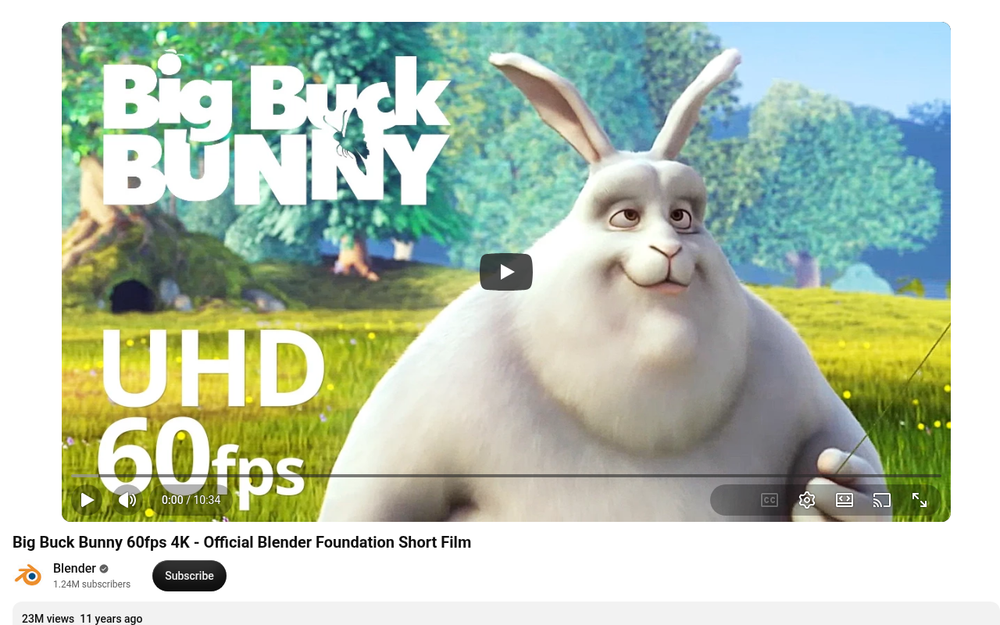
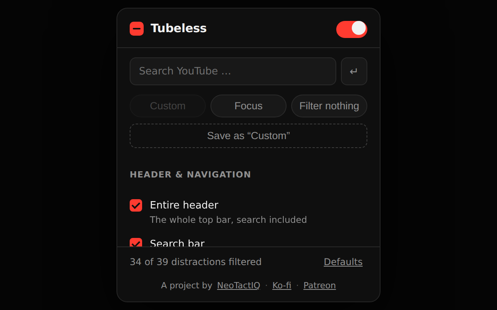

<p align="center">
  
</p>

<h1 align="center">Tubeless</h1>

<p align="center"><em>YouTube without the noise.</em></p>

<p align="center">
  <a href="https://chromewebstore.google.com/detail/ibabglinmoklbdpplofmoicgbknbejee"></a>
  
  
  
  
</p>

<p align="center"><b><a href="https://chromewebstore.google.com/detail/ibabglinmoklbdpplofmoicgbknbejee">Install from the Chrome Web Store</a></b></p>

<p align="center"><em>English version — <a href="README.de.md">Deutsche Fassung</a></em></p>

---

A Chrome extension that reduces YouTube to the thing you came for: the video.
No feed, no recommendations, no Shorts, no comments, no end cards, no autoplay.

42 individually switchable filters, three presets, one of them yours to define.
By default everything distracting is gone — what remains is the player, title,
channel and description.

The interface comes in [twelve languages](#languages), chosen from the
browser's language settings. Store listing copy lives in
[`docs/`](docs/store-listing.en.md).

<table>
  <tr>
    <td width="60%"></td>
    <td width="40%"></td>
  </tr>
  <tr>
    <td align="center"><sub>The watch page: the video, nothing else.</sub></td>
    <td align="center"><sub>The popup: presets, search, 42 filters.</sub></td>
  </tr>
</table>

## Installing

**The easy way:** install it [from the Chrome Web Store](https://chromewebstore.google.com/detail/ibabglinmoklbdpplofmoicgbknbejee) — updates
arrive automatically.

**From source** (for developing or if you want to read what you run):

1. Open `chrome://extensions`
2. Enable **Developer mode** in the top right
3. **Load unpacked** → select this folder
4. Reload YouTube

There is no build step — the folder *is* the extension. Note that the unpacked
copy has a different extension ID than the store version, so the two keep
separate settings.

**Firefox:** load `dist/tubeless-firefox-<version>.xpi` via
`about:debugging#/runtime/this-firefox` → **Load Temporary Add-on** (until the
add-on is listed on addons.mozilla.org). Same code, Firefox 140+; only the
manifest differs — see the header of `tools/build.py`.

## Packaging

One command builds everything, version number in the file name:

```bash
python3 tools/build.py        # -> dist/tubeless-chrome-<v>.zip
                              #    dist/tubeless-firefox-<v>.xpi
                              #    dist/tubeless-<v>.crx (local only, see below)
```

A GitHub Actions workflow runs the same build on every push and commits the
results to `dist/` — after `git pull`, the packages always match the code.
Only the `.crx` is built locally, because it needs the private key.

**Store uploads take the plain ZIP, not the `.crx`** — the Chrome Web Store
signs server-side and rejects `.crx` files as invalid packages. Firefox/AMO
takes the `.xpi`.

`dist/tubeless-<v>.crx` is the signed archive package, extension ID
`inhgfhfdblpbmpohoocoaepcjhoghbij`. Current Chrome versions refuse to install
`.crx` files from outside the Web Store — the file exists for archiving and
distribution; installation goes through the steps above.

The package contains only what is needed at runtime: `manifest.json`,
`_locales/`, `src/`, `popup/`, `icons/`, the README and the LICENSE.
`tools/`, `docs/` and `dist/` stay out.

The `.crx` can also be rebuilt via `chrome://extensions` → **Pack
extension** — this directory as the root, the existing key as the private
key. Without the same key the extension ID changes. `tools/build.py` handles
the snap quirk automatically: snap Chromium can reach neither `~/.config` nor
`/tmp`, so key and staging temporarily live at a path whose first level under
`$HOME` is not a dot-directory ("Could not read private key" otherwise).

The key is **not in the repo** — it lives at `~/.config/tubeless/tubeless.pem`
(mode 600). Whoever holds it can sign packages that Chrome accepts as the same
extension and waves through as an update — which is why `*.pem` is in
`.gitignore`. If it is lost, the extension gets a new ID the next time it is
packed.

## Using it

Click the Tubeless icon in the toolbar:

| Element | Effect |
|---|---|
| Switch in the top right | Pauses Tubeless entirely (YouTube untouched) |
| Search field | Replacement for the hidden YouTube search bar |
| **Custom** | Your saved selection — greyed out until one exists |
| **Focus** | Like the default, but header and search stay; sponsor segments and intros get marked and skipped (SponsorBlock) |
| **Filter nothing** | All filters off |
| **Defaults** (bottom) | Back to the factory settings |

Changes apply immediately, without a reload, in every open tab. Settings live
in `chrome.storage.sync`, so they travel with the Chrome profile.

### Custom selection

As soon as the current selection differs from the saved one, a button appears
below the presets that saves it. From then on **Custom** brings it back at any
time — even after a detour through **Focus** or **Filter nothing**.

The saved selection lives under `_custom` and survives **Defaults**; only
saving again overwrites it.

### Review prompt

At the earliest 30 days after installation, a small block appears in the popup
asking for a Web Store review, and at most every 30 days after that. "Later"
postpones by the same interval, "Write a review" turns it off for good.

Whether a review was actually written is something an extension cannot find
out — Chrome does not reveal it. Whoever clicks "Write a review" therefore
counts as done.

### The header is gone by default

That removes YouTube's search field too — deliberately, because that is where
the pull starts again. You search from the field in the popup. If you would
rather keep the header, pick the **Focus** preset.

## What gets filtered

**Header & navigation** — header, search bar, logo, bell, create button,
account avatar, voice search, sidebar, mini sidebar

**Home & feeds** — home feed, filter chips, Shorts (shelves, grid items, menu
entries), Trending & Explore, promoted/ad placements

**Watch page** — recommended videos, comments, live chat, playlist panel,
merch/tickets/donations, like/share/save, description\*, channel &
subscribe\*, title\*

**Player** — end cards & video wall, pause overlay, info cards, heatmap,
autoplay toggle, next button, miniplayer button, ambient mode

**Everywhere** — red counter badges, thumbnails\*, view counts\*, hover preview

**Behavior** — autoplay permanently off, ad skipping, `/shorts/…` opens as a
regular video, calm placeholder instead of the feed, marking and skipping
sponsor segments — optionally intros too (SponsorBlock, opt-in)\*

\* off by default, individually switchable

## How it works

`src/content.js` runs at `document_start` and sets a class `tl-<name>` on
`<html>` for every active filter; `src/tubeless.css` hangs all rules off these
classes. That way everything is hidden before YouTube renders its first pixel.
The last known settings are additionally kept in `localStorage`, because
`chrome.storage` only answers asynchronously — without it the feed flashes
briefly.

Seven filters need JavaScript instead of CSS: autoplay (sets YouTube's own
`yt-player-autonavstate` and flips the visible toggle if needed), ad skipping,
the three sponsor filters, the Shorts redirect and the placeholder on the
empty home page. These re-run on every SPA navigation
(`yt-navigate-finish` & co.).

### Ads

Nothing is blocked here — things get clicked. As soon as the "Skip" button
shows up, Tubeless presses it; for unskippable ads it jumps to the end of the
ad clip. YouTube treats that like an ad watched to the end, so there is no
quarrel with the adblock detection — but it also does not make YouTube
ad-free. Under MV3 an extension may only block requests through static
`declarativeNetRequest` rules, and ads come from the same domain and partly in
the same stream as the video; there is no clean way to separate them.

Ads appear mid-playback, without navigation and without any change to
`<body>` — the navigation handlers never hear about them. That is why an
interval checks a class on the player every 400 ms. That is more honest than a
MutationObserver over half the player, and it costs practically nothing.

### Sponsor segments (SponsorBlock, opt-in)

Sponsorships baked into the video by the creator cannot be detected by any
local code — they are part of the picture. `src/sponsor.js` therefore uses the
SponsorBlock community database: **marking** draws the reported sections into
the progress bar (sponsor green, intro cyan), **skipping** jumps automatically
to the segment end and briefly shows a toast ("Sponsor skipped"). **Also
include intros** extends both to the intro category. If segments follow each
other back to back, the skip chains through. All three filters are off by
default; as long as neither marking nor skipping is active, not a single
request leaves the browser (asserted via network capture in the test).

Queries go to the k-anonymity endpoint: only the first four hex characters of
the SHA-256 of the video ID are sent, filtering happens locally — the server
never learns which video is playing. Responses are cached per video, failures
included (no retry storm). The API allows CORS from anywhere, so no additional
host permission is needed in the manifest.

### Deliberately missing

**Dislike counts.** YouTube removed them from the API in 2021; the only source
would be the Return-YouTube-Dislike API, which would receive the video ID for
every video — and whose numbers are estimates from someone else's user base
anyway. That cannot be reconciled with "nothing is transmitted", so it stays
out.

No network access in the default configuration, no tracking, no permission
beyond `storage` and `*://*.youtube.com/*`. The only exception are the
SponsorBlock filters above — opt-in, anonymized, switchable.

## Checking selectors

YouTube renames its custom elements regularly. When that happens a selector
silently stops hiding anything. Against that there is a test that loads the
extension into a headless Chromium and counts against the real YouTube:

```bash
python3 -m venv .venv && .venv/bin/pip install websocket-client
.venv/bin/python tools/verify.py            # numbers only
.venv/bin/python tools/verify.py --shots     # plus screenshots
```

Every `FAIL` is a selector in `src/tubeless.css` that needs updating.

## Languages

German, English, Spanish, French, Italian, Japanese, Dutch, Polish,
Portuguese (BR), Russian, Turkish and Simplified Chinese.

The language is picked from `navigator.languages` — that is, from what is set
under `chrome://settings/languages`. Deliberately *not* via `chrome.i18n`:
that follows Chrome's display language, which on Linux hangs off the system
locale and can be an entirely different one than what the user configured.
`src/i18n.js` therefore resolves it itself:

| Browser reports | Tubeless picks |
|---|---|
| `de-AT` | `de` — regional variant falls back to the base language |
| `pt-PT` | `pt_BR` — the only translated region |
| `sv-SE` | `en` — not translated, so fallback |

There is not a single visible string in the code — labels live in
`_locales/<language>/messages.json`: static ones via `data-i18n` attributes in
`popup.html`, dynamic ones via `TUBELESS.label()`, `.hint()`, `.groupLabel()`
and `.t()`. If a key is missing in the chosen language, English steps in; if
it is missing there too, the key name stays visible — so the popup immediately
shows what needs translating.

Chrome reads the same files for the name and description in the manifest. So
that the content script may read them as well, they are listed under
`web_accessible_resources`, restricted to youtube.com.

The keys follow a convention so nothing needs manual wiring:

| Key | Used for |
|---|---|
| `feature<Key>` | Label of a filter, `<Key>` being the key from `features.js` |
| `feature<Key>Hint` | Optional explanation below — absent means a single-line row |
| `group<Id>` | Title of a filter group |
| `extName`, `extDescription` | Name and short description, also for the manifest |

**Adding a language:** copy `_locales/en/messages.json` to
`_locales/<code>/messages.json`, translate the `message` values, leave
`description` untouched (that is the note for translators, not for users) and
add the code to the `AVAILABLE` list in `src/i18n.js`. Nothing else to do —
popup and manifest follow automatically.

Three things to cut yourself on:

- Chrome writes regions with an underscore (`pt_BR`, not `pt-BR`).
- `statusFiltered` must keep `$COUNT$` and `$TOTAL$` — their order in the
  sentence is free, the mapping goes by name.
- `extDescription` must not exceed **132 characters** and `extName` not 75.
  Translations tend to run longer than the English original; if one breaks the
  limit, Chrome refuses to load the extension in that language at all. The
  script below checks this too.

Checking whether a language is complete:

```bash
python3 - <<'EOF'
import json, glob, os, re
base = json.load(open('_locales/en/messages.json'))
declared = re.findall(r"'([\w]+)'", re.search(
    r'const AVAILABLE = \[(.*?)\]', open('src/i18n.js').read(), re.S).group(1))
for path in sorted(glob.glob('_locales/*/messages.json')):
    lang = os.path.basename(os.path.dirname(path))
    cat = json.load(open(path))
    holes = [k for k in base if k not in cat]
    stray = [k for k in cat if k not in base]
    empty = [k for k, v in cat.items() if not v.get('message', '').strip()]
    # Chrome rejects the manifest if the description exceeds 132 characters
    long = [k for k in ('extName', 'extDescription')
            if len(cat.get(k, {}).get('message', '')) > (75 if k == 'extName' else 132)]
    print(f"{lang:6} missing: {holes or '—'} | stray: {stray or '—'}"
          f" | empty: {empty or '—'} | too long: {long or '—'}"
          f" | in i18n.js: {'yes' if lang in declared else 'NO'}")
EOF
```

## Files

```
manifest.json          MV3 manifest
_locales/<language>/   translations (messages.json), twelve languages
src/i18n.js            language pick from navigator.languages, loads catalogs
src/features.js        feature table (keys, groups, defaults, presets, i18n helpers)
src/tubeless.css       all hiding rules, hung off tl-* classes
src/content.js         class toggling, JS filters, SPA navigation
src/sponsor.js         SponsorBlock: markers, skipping, toast (opt-in)
popup/                 the UI
dist/                  store-upload packages, versioned (built by CI + tools/build.py)
docs/store-listing.*   Chrome Web Store copy, per language
docs/logo.svg          the mark, same shape as icons/*.png
tools/build.py         builds all packages into dist/
tools/make-icons.py    generates icons/*.png (no external dependencies)
tools/verify.py        selector test against the real YouTube
```

Adding a filter: create an entry in `src/features.js`, write CSS rules under
`html.tl-<key>` in `src/tubeless.css`, add `feature<Key>` to **all**
`_locales/*/messages.json`. Popup and presets build themselves from that.

One trap: presets must contain **filter values only**. Build them from
`DEFAULTS` and they drag `_enabled`, `_custom` and `_rate` along — and a click
on a preset then wipes the saved selection and resets the review counter.
`selectionFromDefaults()` exists for this.
